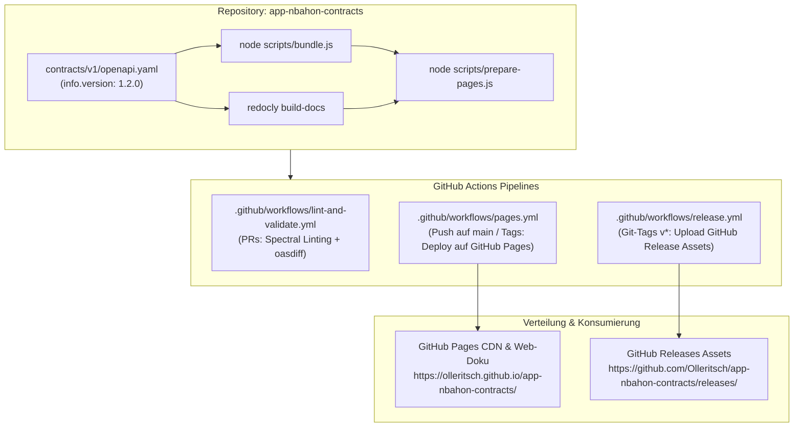

# Gedächtnisprotokoll & Projektstatus: app-nbahon-contracts

> **Zweck dieses Dokuments:** Lückenlose Dokumentation des aktuellen Entwicklungsstands, der Architektur, der getroffenen Entscheidungen und der nächsten Schritte vor einem Neustart des Devcontainers/der Entwicklungsumgebung.

**Stand:** 22. Oktober 2026  
**Aktuelle Spezifikationsversion:** `1.2.0`  
**Aktueller Git-Branch:** `main` (Up-to-date mit `origin/main`)  
**Letzter Commit:** `4cdfeb6` (`feat: add full semver contract bundling and github pages distribution workflow`)  
**Git-Tags im Repository:** `v1.0.0`, `v1.1.0`, `v1.2.0`  

---

## 1. Projektübersicht

`app-nbahon-contracts` ist die **Single Source of Truth** für alle Schnittstellenverträge im nbahon-Ökosystem (OpenAPI 3.1).
Konsumierende Dienste (wie `app-nbahon-natstat-connector`, Gateways oder Mobile/Web-Frontends) generieren ihre DTOs und Controller/Client-Interfaces zur Build-Zeit direkt aus diesen Spezifikationen.

---

## 2. Aktueller Funktionsumfang (Spezifikation v1.2.0)

### A. Endpunkte (`contracts/v1/paths/`)
1. **`GET /api/gamedays/{date}/games`** ([`gamedays.yaml`](contracts/v1/paths/gamedays.yaml))
   - Liefert alle NBA-Partien eines bestimmten Kalendertags (`YYYY-MM-DD`).
   - Tag: `Gamedays`
2. **`GET /api/teams`** ([`teams.yaml`](contracts/v1/paths/teams.yaml))
   - Liefert alle 30 NBA-Franchises.
   - Optionaler Query-Parameter: `conference` (`Eastern` | `Western`).
   - Tag: `Teams`
3. **`GET /api/gamedays/{date}/games/{matchup}`** ([`game-details.yaml`](contracts/v1/paths/game-details.yaml))
   - Liefert Spieldetails für eine bestimmte Paarung (z. B. `DET@MIA`) inklusive optionalem Boxscore.
   - Tag: `Games`
4. **`GET /api/gamedays/{date}/games/{matchup}/boxscore`** ([`boxscore.yaml`](contracts/v1/paths/boxscore.yaml))
   - Liefert vollständige Team- und Spielerstatistiken für das Matchup.
   - Tag: `Games`

### B. Schemas (`contracts/v1/schemas/`)
- **`Game.yaml`**: Grunddaten eines Spiels (ID, Datum, Tip-Off, Status, Teams, Venue, Score).
- **`GameDetails.yaml`**: Erweitert `Game` per `allOf` um das optionale Feld `boxscore`.
- **`TeamGameStats.yaml`**: Aggregierte Team-Statistiken (Punkte, FGM/FGA, 3PM/3PA, FTM/FTA, Rebounds, Assists, Steals, Blocks, Turnovers, Fouls).
- **`PlayerBoxscore.yaml`**: Detaillierte Spielerstatistiken (Starter, Minuten, Punkte, Quoten, Plus/Minus etc.).
- **`Boxscore.yaml`**: Aggregiert `homeTeam`, `awayTeam` (`TeamGameStats`) sowie `homePlayers`, `awayPlayers` (Arrays von `PlayerBoxscore`).
- **`Team.yaml`**: Teamdaten (ID, Name, Kürzel/TLA, Stadt, Conference, Division).
- **`Score.yaml`**: Punktestand mit Periodenübersicht (Quarter / Overtime).
- **`Venue.yaml`**: Spielstätte (Name, Stadt).
- **`TimeZoneInfo.yaml`**: Zeitzoneninformationen (Name, Offset).
- **`GameStatus.yaml`**: Spielstatus-Enum (`SCHEDULED`, `LIVE`, `FINAL`).
- **`ProblemDetail.yaml`**: Standardisierte RFC 9457 Fehlerobjekte (für 400, 404, 500).

---

## 3. Build- und Release-Architektur

Es existieren zwei parallele Verteilungswege:



### A. Vollversioniertes Bundling (`scripts/bundle.js`)
Liest dynamisch `info.version` aus der OpenAPI-Spezifikation und erzeugt in `dist/`:
- `nbahon-contracts-v1.2.0.yaml` und `.json` (Vollversioniert SemVer)
- `nbahon-contracts-v1.yaml` und `.json` (Major-Version Alias)
- `nbahon-contracts-latest.yaml` und `.json` (Latest Alias)
- `nbahon-games-v1.yaml` und `.json` (Legacy-Fallback)

### B. GitHub Pages Distribution & Doku (`scripts/prepare-pages.js` + `.github/workflows/pages.yml`)
Befüllt `public/` und deployt bei jedem Push auf `main` sowie bei Tags auf GitHub Pages:
- **Basis-URL & Interaktive Redoc-Webseite:** `https://olleritsch.github.io/app-nbahon-contracts/`
- **SemVer Pinned (für Production-Services):** `https://olleritsch.github.io/app-nbahon-contracts/v1.2.0/nbahon-contracts.yaml`
- **Vollversionierter Dateiname:** `https://olleritsch.github.io/app-nbahon-contracts/v1.2.0/nbahon-contracts-v1.2.0.yaml`
- **Evergreen Latest (keine 404-Gefahr mehr!):** `https://olleritsch.github.io/app-nbahon-contracts/latest/nbahon-contracts.yaml`
- **Major Evergreen:** `https://olleritsch.github.io/app-nbahon-contracts/v1/nbahon-contracts.yaml`
- *(Alle Pfade existieren parallel auch als `.json`)*

---

## 4. Chronologie der Versionen & Git-Historie

| Version | Git-Tag / Commit | Highlights |
|---|---|---|
| **v1.0.0** | Tag `v1.0.0` (`332e324`) | Initiale OpenAPI 3.1 Spezifikation, Devcontainer, CI (Spectral + oasdiff), Release-Pipeline, `/api/gamedays/{date}/games`. |
| **v1.1.0** | Tag `v1.1.0` (`e46f785`) | Neuer Endpunkt `GET /api/teams` mit `conference`-Filter. |
| **v1.2.0** | Tag `v1.2.0` (`dc78139`) | Matchup-Endpunkte `GET /api/gamedays/{date}/games/{matchup}` und `/boxscore`, Schemas für `TeamGameStats`, `PlayerBoxscore`, `Boxscore`, `GameDetails`. |
| **Post-v1.2.0** | Commit `4cdfeb6` (`HEAD -> main`) | Vollversionierte Dateinamen beim Bündeln, GitHub Pages Workflow (`pages.yml`), `scripts/bundle.js` und `scripts/prepare-pages.js`, Dokumentations-Update. |

---

## 5. Wichtige Befehle zur lokalen Validierung

```bash
# 1. Abhängigkeiten installieren
npm install

# 2. Verträge bündeln (erzeugt alle SemVer-, Major-, Latest- und Legacy-Dateien in dist/)
npm run bundle

# 3. Interaktive HTML-Doku & GitHub Pages Struktur in public/ generieren
npm run build:pages

# 4. Spectral Linting & Bundling-Test ausführen
npm test

# 5. Interaktive Dokumentations-Vorschau im Browser starten
npm run preview
```

---

## 6. Offene To-Dos / Nächste Schritte

1. **GitHub Pages in Repo-Einstellungen aktivieren (einmalig im GitHub Webinterface):**
   - Gehe auf **GitHub: Repository ➔ Settings ➔ Pages**
   - Unter **Build and deployment**: Wähle bei **Source** die Option **"GitHub Actions"**.
   - Danach triggert jeder Push auf `main` den Workflow `.github/workflows/pages.yml` und die Seite ist live.

2. **Konsumierende Services aktualisieren:**
   - In `app-nbahon-natstat-connector` (oder anderen Services) in der `pom.xml` die `inputSpec` auf die neue URL umstellen:
     ```xml
     <inputSpec>https://olleritsch.github.io/app-nbahon-contracts/v1.2.0/nbahon-contracts.yaml</inputSpec>
     ```
   - Build des Services durchführen und neue Klassen für `GameDetails`, `Boxscore`, `TeamGameStats` etc. nutzen.
