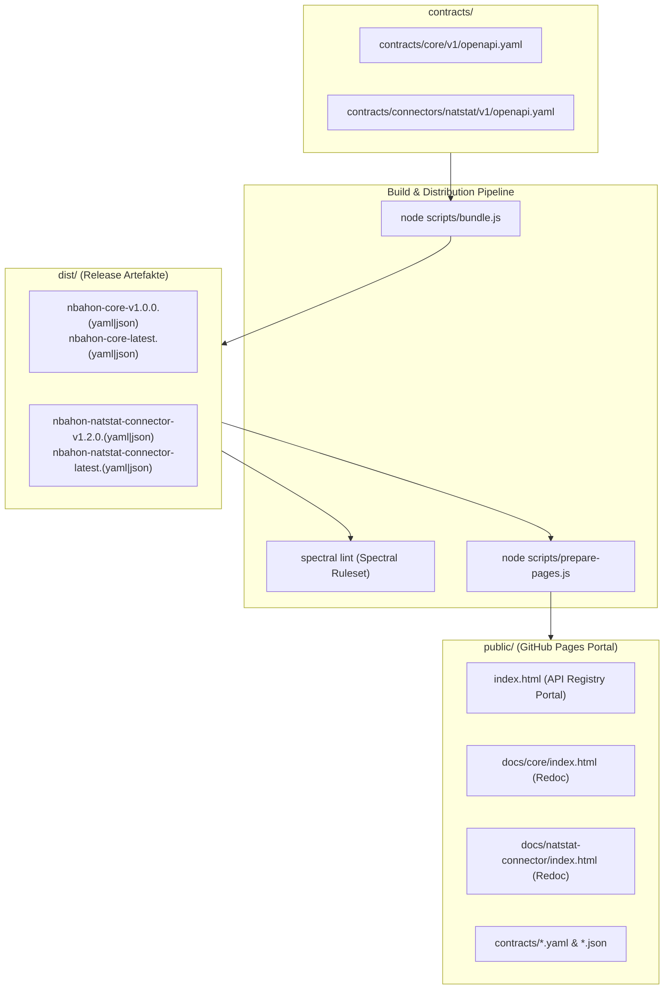

# Gedächtnisprotokoll & Projektstatus: app-nbahon-contracts

> **Zweck dieses Dokuments:** Lückenlose Dokumentation des aktuellen Entwicklungsstands, der Multi-API-Architektur, der getroffenen Entscheidungen und der nächsten Schritte vor einem Neustart des Devcontainers/der Entwicklungsumgebung.

**Stand:** 22. Oktober 2026  
**Architektur:** Multi-API Contract Hub (OpenAPI 3.1)  
**Aktueller Git-Branch:** `main`  
**Registrierte APIs:**
- `nbahon-natstat-connector` (Version: `1.2.0`)
- `nbahon-core` (Version: `1.0.0`)

---

## 1. Projektübersicht

`app-nbahon-contracts` ist die **Single Source of Truth** für alle Schnittstellenverträge im nbahon-Ökosystem (OpenAPI 3.1).
Das Repository beherbergt als Multi-API Hub sowohl Upstream-BFF-Verträge (`nbahon-core`) als auch Downstream-Konnektor-Verträge (`nbahon-natstat-connector`).
Alle Verträge werden modular gepflegt (`paths/` und `schemas/`), per Redocly gebündelt und automatisiert über ein modernes GitHub Pages Portal sowie GitHub Releases bereitgestellt.

---

## 2. Struktur der API-Verträge (`contracts/`)

```text
contracts/
├── connectors/
│   └── natstat/
│       └── v1/                          <-- NatStat Downstream Connector (v1.2.0)
│           ├── openapi.yaml
│           ├── paths/
│           │   ├── gamedays.yaml        (GET /api/gamedays/{date}/games)
│           │   ├── game-details.yaml    (GET /api/gamedays/{date}/games/{matchup})
│           │   ├── boxscore.yaml        (GET /api/gamedays/{date}/games/{matchup}/boxscore)
│           │   └── teams.yaml           (GET /api/teams)
│           └── schemas/
│               ├── Game.yaml
│               ├── GameDetails.yaml
│               ├── Boxscore.yaml
│               ├── TeamGameStats.yaml
│               ├── PlayerBoxscore.yaml
│               ├── Team.yaml
│               ├── Score.yaml
│               ├── Venue.yaml
│               ├── TimeZoneInfo.yaml
│               ├── GameStatus.yaml
│               └── ProblemDetail.yaml
└── core/
    └── v1/                              <-- Core Orchestrator & BFF API (v1.0.0)
        ├── openapi.yaml
        ├── paths/
        │   ├── gamedays.yaml            (GET /api/v1/core/gamedays/{date})
        │   └── games.yaml               (GET /api/v1/core/games/{date}/{matchup})
        └── schemas/
            ├── AggregatedGameday.yaml
            ├── AggregatedGame.yaml
            ├── AggregatedGameView.yaml
            ├── TeamOverview.yaml
            ├── ScoreSummary.yaml
            ├── MatchupOverview.yaml
            ├── GameAnalysis.yaml
            └── ProblemDetail.yaml
```

---

## 3. Build-, Validierungs- und Bereitstellungsarchitektur



### A. Bundling (`scripts/bundle.js`)
Liest alle registrierten APIs aus, ermittelt dynamisch die SemVer-Version und erzeugt in `dist/`:
- `nbahon-core-v1.0.0.yaml` & `.json`
- `nbahon-core-latest.yaml` & `.json`
- `nbahon-natstat-connector-v1.2.0.yaml` & `.json`
- `nbahon-natstat-connector-latest.yaml` & `.json`

### B. GitHub Pages Portal (`scripts/prepare-pages.js`)
Erzeugt die statische Webpräsenz in `public/`:
- **Portal Landing Page:** `https://olleritsch.github.io/app-nbahon-contracts/`
- **Interaktive Redoc Dokumentationen:**
  - Core BFF: `https://olleritsch.github.io/app-nbahon-contracts/docs/core/`
  - NatStat Connector: `https://olleritsch.github.io/app-nbahon-contracts/docs/natstat-connector/`
- **Direkt-Download & Codegen-URLs (SemVer Pinned & Latest):**
  - Core v1.0.0: `https://olleritsch.github.io/app-nbahon-contracts/contracts/nbahon-core-v1.0.0.yaml`
  - Core Latest: `https://olleritsch.github.io/app-nbahon-contracts/contracts/nbahon-core-latest.yaml`
  - NatStat Connector v1.2.0: `https://olleritsch.github.io/app-nbahon-contracts/contracts/nbahon-natstat-connector-v1.2.0.yaml`
  - NatStat Connector Latest: `https://olleritsch.github.io/app-nbahon-contracts/contracts/nbahon-natstat-connector-latest.yaml`

---

## 4. GitHub Actions Workflows

1. **`.github/workflows/pages.yml`**:
   - Triggert bei Pushes auf `main` und bei Tags `v*`.
   - Baut alle Contracts und Dokumentationen (`npm run build:pages`) und veröffentlicht sie auf GitHub Pages.
2. **`.github/workflows/lint-and-validate.yml`**:
   - Triggert bei Pull Requests und Pushes auf `develop`.
   - Führt Bündelung und Spectral Linting durch (`npm test`).
   - Führt oasdiff Breaking-Change-Prüfung gegen den `main`-Branch für alle APIs aus.
3. **`.github/workflows/release.yml`**:
   - Triggert bei Tags `v*`.
   - Bündelt alle Verträge und lädt die Artefakte aus `dist/*` in das GitHub Release hoch.

---

## 5. Wichtige Befehle zur lokalen Validierung

```bash
# 1. Abhängigkeiten installieren
npm install

# 2. Verträge aller APIs bündeln
npm run bundle

# 3. Spectral Linting ausführen
npm run lint

# 4. Gesamter Build- & Testablauf (Bundle + Lint)
npm test

# 5. Interaktive HTML-Dokus & Portal in public/ generieren
npm run build:pages

# 6. Live-Vorschau im Browser starten
npm run preview:core      # Core BFF API
npm run preview:natstat   # NatStat Connector API
```

---

## 6. Nächste Schritte

1. **Konsumierende Services anbinden bzw. umstellen:**
   - In `app-nbahon-natstat-connector` in der `pom.xml` die URL auf die neue saubere URL umstellen:
     ```xml
     <inputSpec>https://olleritsch.github.io/app-nbahon-contracts/contracts/nbahon-natstat-connector-v1.2.0.yaml</inputSpec>
     ```
   - Im `app-nbahon-core` Repo die Core-Spezifikation für DTO-/Interface-Generierung einbinden:
     ```xml
     <inputSpec>https://olleritsch.github.io/app-nbahon-contracts/contracts/nbahon-core-v1.0.0.yaml</inputSpec>
     ```
