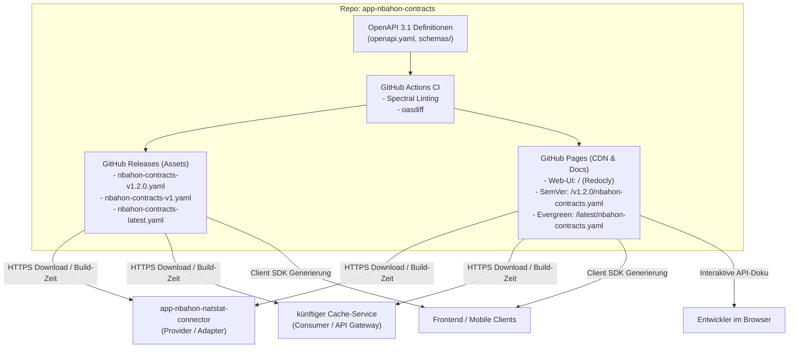

# app-nbahon-contracts

> **Zentrale, versionierte OpenAPI 3.1 Spezifikationen als Single Source of Truth für das nbahon-Ökosystem.**

Dieses Repository stellt sprachneutrale Contract-Definitionen bereit. Es dient als zentrale Referenz für Schnittstellen zwischen Microservices (wie `app-nbahon-natstat-connector` oder dem API Gateway / Cache-Service) sowie externen Clients.

---

## Architektur



---

## Verzeichnisstruktur

```text
app-nbahon-contracts/
├── .devcontainer/
│   └── devcontainer.json            # VS Code Devcontainer (Node.js 20, Tools & Extensions)
├── .github/
│   └── workflows/
│       ├── lint-and-validate.yml    # CI bei PRs (Spectral + oasdiff)
│       ├── pages.yml                # Deployt Dokumentation & Specs auf GitHub Pages
│       └── release.yml              # Erstellt Release-Assets bei Tags (v*)
├── contracts/
│   └── v1/
│       ├── openapi.yaml             # Hauptspezifikation (Root v1)
│       ├── paths/
│       │   ├── gamedays.yaml        # Endpunkte: /api/gamedays/{date}/games
│       │   ├── game-details.yaml    # Endpunkte: /api/gamedays/{date}/games/{matchup}
│       │   ├── boxscore.yaml        # Endpunkte: /api/gamedays/{date}/games/{matchup}/boxscore
│       │   └── teams.yaml           # Endpunkte: /api/teams
│       └── schemas/
│           ├── Game.yaml            # Schema: Game
│           ├── GameDetails.yaml     # Schema: GameDetails
│           ├── Boxscore.yaml        # Schema: Boxscore
│           ├── TeamGameStats.yaml   # Schema: TeamGameStats
│           ├── PlayerBoxscore.yaml  # Schema: PlayerBoxscore
│           ├── Team.yaml            # Schema: Team
│           ├── Venue.yaml           # Schema: Venue
│           ├── Score.yaml           # Schema: Score
│           ├── TimeZoneInfo.yaml    # Schema: TimeZoneInfo
│           ├── GameStatus.yaml      # Schema: GameStatus (Enum)
│           └── ProblemDetail.yaml   # Schema: ProblemDetail (RFC 9457)
├── docs/
│   └── README.md                    # Detaillierter Leitfaden zur Konsumierung
├── scripts/
│   ├── bundle.js                    # Bündelt Verträge mit SemVer & Alias-Dateien
│   └── prepare-pages.js             # Bereitet Ordnerstruktur für GitHub Pages vor
├── .spectral.yaml                   # Linting-Regelsatz für OpenAPI Styleguide
├── .gitignore
├── LICENSE
├── package.json                     # Tooling-Konfiguration (Redocly, Spectral)
└── README.md
```

---

## Schnellstart & Lokale Entwicklung

### Verwendung mit Devcontainer
Öffne das Projekt einfach in VS Code mit der Option **"Reopen in Container"**. Alle benötigten Erweiterungen (Redocly, Spectral, YAML) und Tools sind sofort einsatzbereit.

### Lokale CLI-Befehle

1. **Abhängigkeiten installieren:**
   ```bash
   npm install
   ```

2. **Linting mit Spectral:**
   ```bash
   npm run lint
   ```

3. **Bündeln zu monolithischen Release-Dateien:**
   ```bash
   npm run bundle
   ```
   Erzeugt vollversionierte SemVer-Dateien (z. B. `dist/nbahon-contracts-v1.2.0.yaml`), Major-Aliase (`v1`), `latest` sowie Legacy-Fallbacks (`games-v1`).

4. **GitHub Pages lokal vorbereiten & HTML-Dokumentation bauen:**
   ```bash
   npm run build:pages
   ```
   Erzeugt die interaktive Dokumentation (`public/index.html`) sowie alle versionierten Pages-Dateien in `public/`.

5. **Vollständiger Testlauf (Lint + Bundle):**
   ```bash
   npm test
   ```

6. **Interaktive Dokumentations-Vorschau (Live-Server):**
   ```bash
   npm run preview
   ```

---

## Verteilung & Releases

### A. GitHub Pages CDN & Web-Dokumentation (Empfohlen)
Die Verträge werden automatisch bei Pushes auf `main` sowie bei Tags via GitHub Actions nach GitHub Pages ausgeliefert:
- **Basis-URL:** `https://olleritsch.github.io/app-nbahon-contracts/`
- **Interaktive Doku:** `https://olleritsch.github.io/app-nbahon-contracts/`
- **SemVer (Pinned):** `https://olleritsch.github.io/app-nbahon-contracts/v1.2.0/nbahon-contracts.yaml` (und `.json`)
- **Evergreen Latest:** `https://olleritsch.github.io/app-nbahon-contracts/latest/nbahon-contracts.yaml`
- **Major Evergreen:** `https://olleritsch.github.io/app-nbahon-contracts/v1/nbahon-contracts.yaml`

### B. GitHub Releases (Assets)
1. Änderungen per Pull Request auf `main` mergen.
2. Git-Tag setzen und pushen:
   ```bash
   git tag v1.2.0
   git push origin v1.2.0
   ```
3. Der GitHub Workflow `.github/workflows/release.yml` erstellt automatisch ein GitHub-Release mit allen Assets aus `dist/`:
   - `nbahon-contracts-v1.2.0.yaml` / `.json` (Vollversioniert)
   - `nbahon-contracts-v1.yaml` / `.json` (Major Alias)
   - `nbahon-contracts-latest.yaml` / `.json` (Latest Alias)
   - `nbahon-games-v1.yaml` / `.json` (Legacy Fallback)

---

## Konsumierung in Services

Ausführliche Code-Beispiele für die Anbindung via Maven (`openapi-generator-maven-plugin`) oder Client-Generatoren findest du in [docs/README.md](docs/README.md).

---

## Lizenz

Proprietär – Alle Rechte vorbehalten. Siehe [LICENSE](LICENSE).

