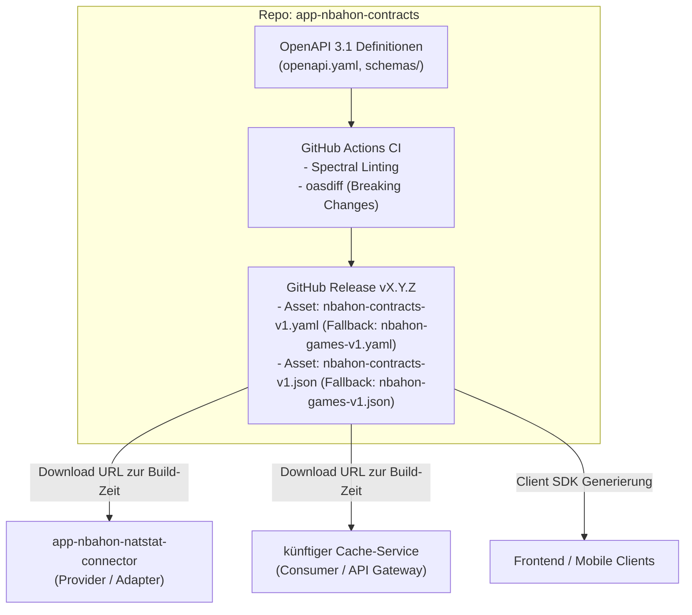

# app-nbahon-contracts

> **Zentrale, versionierte OpenAPI 3.1 Spezifikationen als Single Source of Truth für das nbahon-Ökosystem.**

Dieses Repository stellt sprachneutrale Contract-Definitionen bereit. Es dient als zentrale Referenz für Schnittstellen zwischen Microservices (wie `app-nbahon-natstat-connector` oder dem API Gateway / Cache-Service) sowie externen Clients.

---

## Architektur



---

## Verzeichnisstruktur

```text
app-nbahon-contracts/
├── .devcontainer/
│   └── devcontainer.json            # VS Code Devcontainer (Node.js 20, Tools & Extensions)
├── .github/
│   └── workflows/
│       ├── lint-and-validate.yml    # CI bei PRs (Spectral + oasdiff)
│       └── release.yml              # Erstellt Release-Assets bei Tags (v*)
├── contracts/
│   └── v1/
│       ├── openapi.yaml             # Hauptspezifikation (Root v1)
│       ├── paths/
│       │   ├── gamedays.yaml        # Endpunkte: /api/gamedays/{date}/games
│       │   └── teams.yaml           # Endpunkte: /api/teams
│       └── schemas/
│           ├── game.yaml            # Schema: Game
│           ├── team.yaml            # Schema: Team
│           ├── venue.yaml           # Schema: Venue
│           ├── score.yaml           # Schema: Score
│           ├── timezone-info.yaml   # Schema: TimeZoneInfo
│           ├── game-status.yaml     # Schema: GameStatus (Enum)
│           └── problem-detail.yaml  # Schema: ProblemDetail (RFC 9457)
├── docs/
│   └── README.md                    # Detaillierter Leitfaden zur Konsumierung
├── .spectral.yaml                   # Linting-Regelsatz für OpenAPI Styleguide
├── .gitignore
├── LICENSE
├── package.json                     # Tooling-Konfiguration (Redocly, Spectral)
└── README.md
```

---

## Schnellstart & Lokale Entwicklung

### Verwendung mit Devcontainer
Öffne das Projekt einfach in VS Code mit der Option **"Reopen in Container"**. Alle benötigten Erweiterungen (Redocly, Spectral, YAML) und Tools sind sofort einsatzbereit.

### Lokale CLI-Befehle

1. **Abhängigkeiten installieren:**
   ```bash
   npm install
   ```

2. **Linting mit Spectral:**
   ```bash
   npm run lint
   ```

3. **Bündeln zu monolithischen Release-Dateien:**
   ```bash
   npm run bundle
   ```
   Erzeugt `dist/nbahon-contracts-v1.yaml` und `dist/nbahon-contracts-v1.json` (sowie Alias-Kopien `dist/nbahon-games-v1.yaml` und `dist/nbahon-games-v1.json`).

4. **Vollständiger Testlauf (Lint + Bundle):**
   ```bash
   npm test
   ```

5. **Interaktive Dokumentations-Vorschau:**
   ```bash
   npm run preview
   ```

---

## Release-Workflow

1. Änderungen per Pull Request auf `develop` bzw. `main` mergen (CI validiert Syntax, Bundling und Abwärtskompatibilität).
2. Git-Tag setzen und pushen:
   ```bash
   git tag v1.1.0
   git push origin v1.1.0
   ```
3. Der GitHub Workflow `.github/workflows/release.yml` erstellt automatisch ein GitHub-Release mit den gebündelten Artefakten:
   - `nbahon-contracts-v1.yaml` (und Fallback `nbahon-games-v1.yaml`)
   - `nbahon-contracts-v1.json` (und Fallback `nbahon-games-v1.json`)

---

## Konsumierung in Services

Ausführliche Code-Beispiele für die Anbindung via Maven (`openapi-generator-maven-plugin`) oder Client-Generatoren findest du in [docs/README.md](docs/README.md).

---

## Lizenz

Proprietär – Alle Rechte vorbehalten. Siehe [LICENSE](LICENSE).

