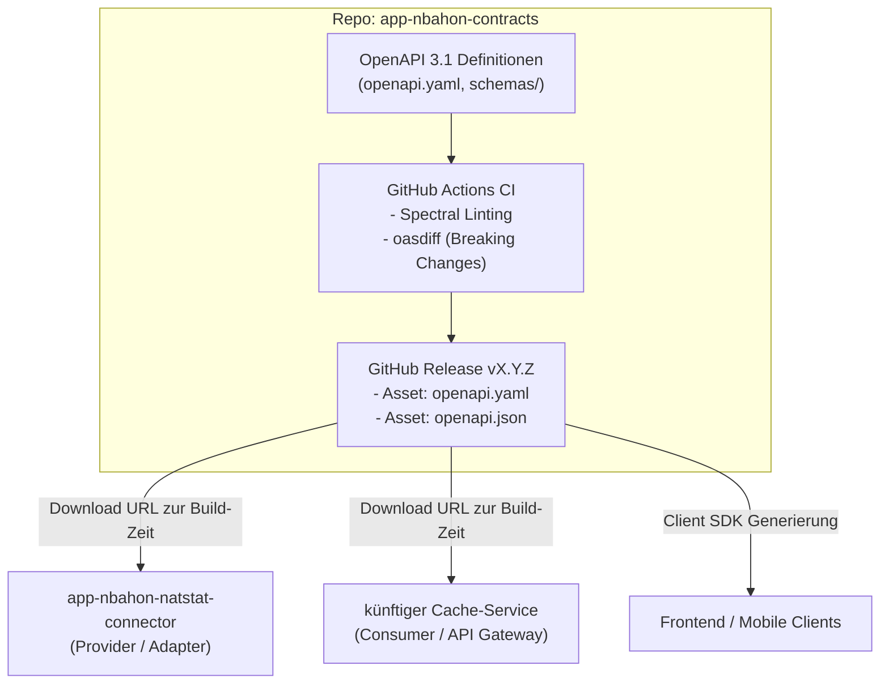

# Implementierungsplan: `app-nbahon-contracts`

> **Ziel:** Aufbau eines eigenständigen, sprachneutralen Contract-Repositorys (`app-nbahon-contracts`) als **Single Source of Truth** für das nbahon-Ökosystem.
> Das Repository stellt versionierte OpenAPI 3.1 Spezifikationen als GitHub Release-Assets bereit, die von Microservices (wie `app-nbahon-natstat-connector` oder dem künftigen Cache-Service) zur Compile-Zeit per URL bezogen werden.

---

## 1. Repository-Übersicht & Architektur



---

## 2. Empfohlene Verzeichnisstruktur

```text
app-nbahon-contracts/
├── .github/
│   └── workflows/
│       ├── lint-and-validate.yml    # CI bei PRs (Spectral + oasdiff)
│       └── release.yml              # Erstellt Release-Assets bei Tags
├── contracts/
│   └── v1/
│       ├── openapi.yaml             # Hauptspezifikation (Root v1)
│       ├── paths/
│       │   └── gamedays.yaml        # Endpunkte: /api/gamedays/{date}/games
│       └── schemas/
│           ├── game.yaml            # Schema: Game
│           ├── team.yaml            # Schema: Team
│           ├── venue.yaml           # Schema: Venue
│           ├── score.yaml           # Schema: Score
│           ├── timezone-info.yaml   # Schema: TimeZoneInfo
│           ├── game-status.yaml     # Schema: GameStatus (Enum)
│           └── problem-detail.yaml  # Schema: ProblemDetail (RFC 9457)
├── docs/
│   └── README.md                    # Doku für Entwickler (Wie konsumiere ich?)
├── .spectral.yaml                   # Regeln für API-Styleguide
├── .gitignore
├── LICENSE
└── README.md
```

> [!TIP]
> Die Aufteilung in `paths/` und `schemas/` hält die Spezifikation übersichtlich und modular. Für das Release-Artefakt bündeln wir die modularen Dateien per CLI-Tool (`redocly bundle`) in eine einzige, in sich geschlossene `openapi.yaml`.

---

## 3. Schritt-für-Schritt-Setup

### Schritt 3.1: Repository initialisieren
1. Neues GitHub-Repository anlegen: `Olleritsch/app-nbahon-contracts` (Public oder Private mit Token-Zugriff).
2. Lokal klonen und Gitflow / Conventional Commits einrichten.

### Schritt 3.2: OpenAPI 3.1 Schemas anlegen
Die Schemas basieren auf dem bereits im Connector erprobten Entwurf:

#### `contracts/v1/openapi.yaml` (Haupt-Spec)
```yaml
openapi: 3.1.0
info:
  title: nbahon API Contracts
  version: 1.0.0
  description: Zentrale Schnittstellenverträge für das NBA-Ökosystem von nbahon.
  contact:
    name: Oliver (@Olleritsch)
servers:
  - url: http://localhost:8080
    description: Lokale Entwicklung

paths:
  /api/gamedays/{date}/games:
    $ref: './paths/gamedays.yaml#/getGamesForDate'

components:
  schemas:
    Game:
      $ref: './schemas/game.yaml'
    GameStatus:
      $ref: './schemas/game-status.yaml'
    Team:
      $ref: './schemas/team.yaml'
    Venue:
      $ref: './schemas/venue.yaml'
    TimeZoneInfo:
      $ref: './schemas/timezone-info.yaml'
    Score:
      $ref: './schemas/score.yaml'
    ProblemDetail:
      $ref: './schemas/problem-detail.yaml'
```

#### `contracts/v1/schemas/game.yaml`
```yaml
type: object
required:
  - id
  - gameDate
  - status
  - homeTeam
  - awayTeam
  - venue
properties:
  id:
    type: string
    description: Global eindeutige ID des Spiels.
    example: "1438667"
  gameDate:
    type: string
    format: date
    description: Kalendertag des Spiels (ISO-8601).
    example: "2026-04-12"
  startTime:
    type: string
    format: date-time
    nullable: true
    description: Geplanter Anwurf (Tip-off) mit Zeitzonen-Offset. Null falls noch unbestimmt (TBD).
    example: "2026-04-12T19:30:00-04:00"
  timeZone:
    $ref: './timezone-info.yaml'
  status:
    $ref: './game-status.yaml'
  homeTeam:
    $ref: './team.yaml'
  awayTeam:
    $ref: './team.yaml'
  venue:
    $ref: './venue.yaml'
  score:
    $ref: './score.yaml'
```

---

### Schritt 3.3: Linting & Styleguide (`.spectral.yaml`)
Spectral prüft automatisch, ob alle Endpunkte Beschreibungen, OperationIDs, Tags und Status-Codes haben:

```yaml
extends: ["spectral:oas"]
rules:
  operation-operationId-valid-in-url: true
  info-contact: error
  no-$ref-siblings: error
  typed-enum: error
```

---

### Schritt 3.4: CI-Workflow für Pull Requests (`.github/workflows/lint-and-validate.yml`)
Läuft bei jedem PR gegen `main` oder `develop`:
1. **Linting:** Prüft Syntax und Richtlinien mit Spectral.
2. **Bundling-Test:** Prüft, ob `redocly bundle` ohne Fehler auflöst.
3. **Breaking-Change-Check:** Vergleicht via `oasdiff` den PR-Branch mit `main`. Schlägt fehl, falls ein Breaking Change ohne Major-Versionssprung vorgenommen wurde.

```yaml
name: Validate OpenAPI Contracts

on:
  pull_request:
    branches: [main, develop]
  push:
    branches: [develop]

jobs:
  validate:
    runs-on: ubuntu-latest
    steps:
      - name: Checkout PR branch
        uses: actions/checkout@v4

      - name: Setup Node.js
        uses: actions/setup-node@v4
        with:
          node-version: '20'

      - name: Install Redocly & Spectral
        run: npm install -g @redocly/cli @stoplight/spectral-cli

      - name: Lint with Spectral
        run: spectral lint contracts/v1/openapi.yaml --ruleset .spectral.yaml

      - name: Test Bundling
        run: redocly bundle contracts/v1/openapi.yaml -o dist/openapi.yaml

      - name: Checkout main for Breaking Change Check
        uses: actions/checkout@v4
        with:
          ref: main
          path: main-branch

      - name: Check for Breaking Changes with oasdiff
        uses: oasdiff/oasdiff-action/breaking@v0.0.18
        with:
          base: main-branch/contracts/v1/openapi.yaml
          revision: contracts/v1/openapi.yaml
          fail-on-diff: true
```

---

### Schritt 3.5: Release-Workflow (`.github/workflows/release.yml`)
Triggert automatisch bei neuen Git-Tags (z. B. `git tag v1.0.0 && git push origin v1.0.0`):
1. Bündelt alle Unterdateien zu einer eigenständigen `openapi.yaml` und `openapi.json`.
2. Erstellt einen GitHub Release und hängt beide Dateien als **Release-Assets** an.

```yaml
name: Release Contracts

on:
  push:
    tags:
      - 'v*'

jobs:
  release:
    runs-on: ubuntu-latest
    permissions:
      contents: write
    steps:
      - name: Checkout
        uses: actions/checkout@v4

      - name: Setup Node.js
        uses: actions/setup-node@v4
        with:
          node-version: '20'

      - name: Install Redocly CLI
        run: npm install -g @redocly/cli

      - name: Build Bundled Artifacts
        run: |
          mkdir -p dist
          redocly bundle contracts/v1/openapi.yaml -o dist/nbahon-games-v1.yaml
          redocly bundle contracts/v1/openapi.yaml -o dist/nbahon-games-v1.json

      - name: Create GitHub Release and Upload Assets
        uses: softprops/action-gh-release@v2
        with:
          files: |
            dist/nbahon-games-v1.yaml
            dist/nbahon-games-v1.json
          generate_release_notes: true
```

Die daraus resultierende Download-URL für andere Services lautet dann exakt:
```text
https://github.com/Olleritsch/app-nbahon-contracts/releases/download/v1.0.0/nbahon-games-v1.yaml
```

---

## 4. Anbindung im Connector Microservice (`app-nbahon-natstat-connector`)

Sobald das Release `v1.0.0` im neuen Repo existiert, stellst du in der [`pom.xml`](file:///workspaces/app-nbahon-natstat-connector/pom.xml) des Connectors lediglich `<inputSpec>` um:

```xml
<plugin>
    <groupId>org.openapitools</groupId>
    <artifactId>openapi-generator-maven-plugin</artifactId>
    <version>7.12.0</version>
    <executions>
        <execution>
            <id>generate-nbahon-contracts</id>
            <goals>
                <goal>generate</goal>
            </goals>
            <configuration>
                <!-- URL zum Release-Asset des Contracts-Repositorys -->
                <inputSpec>https://github.com/Olleritsch/app-nbahon-contracts/releases/download/v1.0.0/nbahon-games-v1.yaml</inputSpec>
                <generatorName>spring</generatorName>
                <library>spring-boot</library>
                <apiPackage>click.dempster.nbahon.contracts.v1.api</apiPackage>
                <modelPackage>click.dempster.nbahon.contracts.v1.model</modelPackage>
                <configOptions>
                    <useSpringBoot3>true</useSpringBoot3>
                    <reactive>true</reactive>
                    <interfaceOnly>true</interfaceOnly>
                    <skipDefaultInterface>true</skipDefaultInterface>
                    <useTags>true</useTags>
                    <openApiNullable>false</openApiNullable>
                </configOptions>
            </configuration>
        </execution>
    </executions>
</plugin>
```

> [!NOTE]
> Die lokale Datei `src/main/resources/contracts/nbahon-games-v1.yaml` im Connector dient aktuell als Übergangslösung. Sobald dein neues Repo live ist und die URL eingetragen wurde, kann die lokale Kopie gelöscht werden.

---

## 5. Versionierungs-Regeln für das Contracts-Repo

| Änderung | SemVer | URL / Tag | Media-Type |
|---|---|---|---|
| Beschreibungstexte, Beispiele korrigiert | **Patch** (`v1.0.1`) | `.../v1.0.1/...` | `application/vnd.nbahon.v1+json` |
| Neues optionales Feld (z. B. `broadcaster`), neuer Endpunkt | **Minor** (`v1.1.0`) | `.../v1.1.0/...` | `application/vnd.nbahon.v1+json` |
| Feld umbenannt/gelöscht, Pflichtfeld ergänzt | **Major** (`v2.0.0`) | `.../v2.0.0/...` | `application/vnd.nbahon.v2+json` |